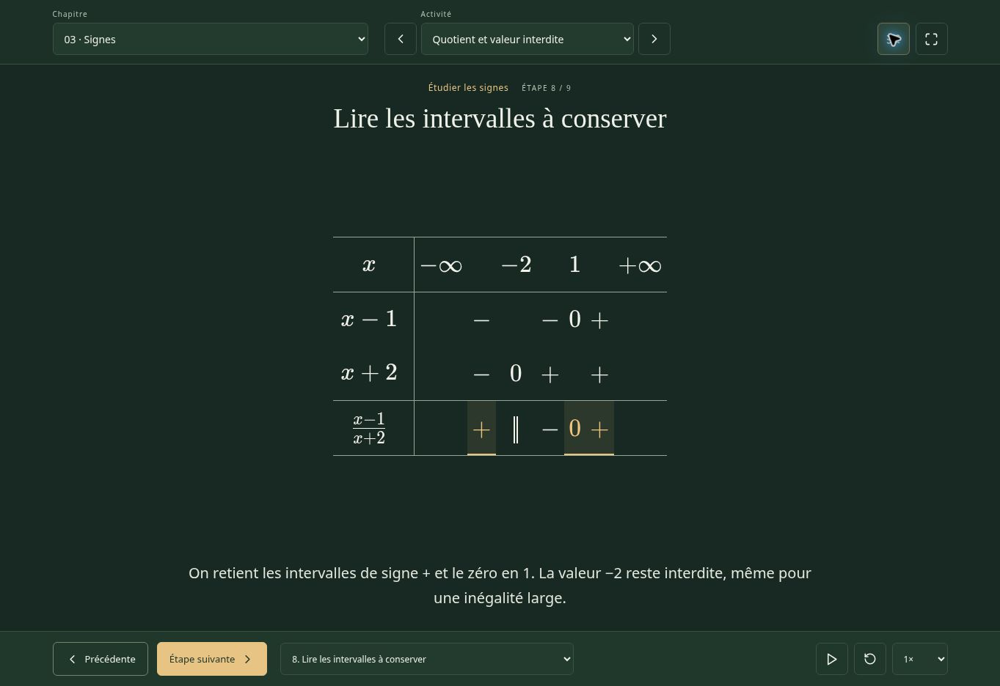

# Atelier Presentations

A reusable presentation starter extracted from [Atelier Fonctions](https://github.com/Malek452/atelier-fonctions). It keeps the dark green board, readable mathematics, and deliberate animations from that project. Students move through an explanation; there are no accounts, quizzes, answer fields, or grading services.

[Live MSN presentation](https://malek452.github.io/atelier-presentations/) · [Version française](README.fr.md) · [Authoring guide](docs/AUTHORING.md) · [Animation recipes](docs/ANIMATIONS.md) · [Instructions for coding assistants](AGENTS.md)



## Current presentation: linear and exponential models

The active French deck teaches a reusable modelling method and exercises 2 and 5 from the supplied `TD1-MSN-corrige-complet.tex`. It covers piecewise affine production with a pause, continuous exponential growth, evaluation, logarithmic threshold solving, explicit assumptions and accessible graphs. The original examples remain reusable fixtures in `examples/`.

[Method](https://malek452.github.io/atelier-presentations/#activity/choisir-modele) · [Exercise 2](https://malek452.github.io/atelier-presentations/#activity/ex2-reperes) · [Exercise 5](https://malek452.github.io/atelier-presentations/#activity/ex5-modele) · [Printable handout](https://malek452.github.io/atelier-presentations/handout/)

## Start your own presentation

1. Choose **Use this template → Create a new repository** on GitHub, or clone/download this repository.
2. Install **Node.js 24 LTS** (the version is also in `.nvmrc`).
3. From the project directory:

```sh
npm ci
npm run dev
```

Open the local URL printed by Vite. The first launch compiles the equations and animation player. Saving lesson files recompiles that player; the development server restarts with its new fingerprinted URL. Reload the page after that restart. Changes to React components and CSS use normal Vite hot reload.

```sh
npm run new:lesson -- my-lesson "My lesson"
```

This creates and registers `src/content/my-lesson.ts`, with a small working equation example to replace. It does not generate the subject matter of your lesson. Its permanent link is `#activity/my-lesson`.

## What to customize

| File | Purpose |
| --- | --- |
| `presentation.config.ts` | Browser title, description, French/English controls, chapter/activity labels, preference storage key |
| `src/theme.ts` | Board and mathematical role colors, shared by the interface and animation engine |
| `src/content/index.ts` | Presentation order and registered lesson modules |
| `src/content/*.ts` | Statements, reasoning, justifications, highlights and animation cues |
| `examples/*.ts` | Bundled working recipes; keep them as references when replacing the active deck |
| `src/types.ts` | Typed content contract |
| `AGENTS.md` | Editing instructions for LLMs and coding agents |

The example content is in French. Setting `locale: 'en'` changes controls and accessibility labels; it does **not** translate authored lessons or the French authoring helpers. Set `sectionLabel` and `activityLabel` too. Give each published presentation its own `storageKey` if it should have independent reduced-motion preferences.

## Included examples

- Powers: common bases, adding/subtracting exponents, and a power of a power.
- Algebra: distributing one factor at a time, computing products, collecting like terms, and finding both roots of a quadratic.
- A French sign table: ordered critical points, zero versus forbidden value, then selected intervals.
- A unit-circle explanation with the radius and coordinate projection.
- A text-only explanation that uses the same board and navigation.

These are authoring examples, not the complete original worksheet. Replace them for a new course. The template supports mathematics and short text explanations; arbitrary diagrams or other subject-specific animations require authored code.

## Reader controls

Use the two selectors to change chapter and activity. Move between steps using the buttons, **← / →**, or a horizontal swipe on the main board. The step selector jumps directly to a settled state. Play, pause, replay, speed controls, reduced motion, and browser fullscreen are included. **Space** toggles automatic playback when focus is outside a control. Overflowing tables keep their own horizontal scrolling.

Backward navigation and direct jumps display the finished step; they do not play a mathematically misleading reverse transformation. Replay shows the authored forward transition. The only persistent data is a local reduced-motion preference. Activity links are shareable, but there is no student progress tracking.

## Validate and publish

```sh
npm test          # content, mathematics, navigation and animation regressions
npm run build    # typecheck, glyph compilation, Motion Canvas, handout and React
npm run preview  # serve the production build locally
# or run both test and build:
npm run validate
```

Deploy **`dist/`** to a static host. [Deployment instructions](docs/DEPLOYMENT.md) cover GitHub Pages and Netlify. No backend, API key, paid correction service or runtime font CDN is required. The build includes a printable, searchable handout at `handout/` and `handout/handout.md`.

GitHub CI runs tests and the production build on pushes and pull requests. The **Deploy to GitHub Pages** workflow validates and publishes each push to `main`; it also supports manual dispatch. Pages is already enabled for this repository.

## Working with an LLM

Open this repository in your coding assistant and ask it to read `AGENTS.md`, then use one of the [ready-to-copy prompts](docs/LLM-PROMPTS.md). Give it your actual source material and intended audience. Request a mathematical review and a real test/build run before accepting a generated deck.

The build checks types, TeX, exact animation references and sign-table structure. It cannot prove a new lesson correct or judge every explanation. The sample mathematics has additional regression tests. Visual and mathematical review remain part of authoring.

## Framework and maintenance

React + TypeScript manage navigation. Motion Canvas 3.17.2 animates precompiled MathJax SVG glyphs. KaTeX renders accessible/static formulas and the handout. Most edits belong in content files; the animation engine is shared.

See [architecture and limitations](docs/ARCHITECTURE.md) and the [dependency maintenance note](docs/MAINTENANCE.md), including the inherited Motion Canvas/Vite compatibility constraint. Development servers bind to localhost by default and are not the deployment artifact.

## License

MIT. You can reuse and adapt this starter, including commercially, while retaining its license notice. See [LICENSE](LICENSE) and [third-party notices](THIRD-PARTY-NOTICES.md). When importing external teaching material, obtain any permissions required for that material separately.
